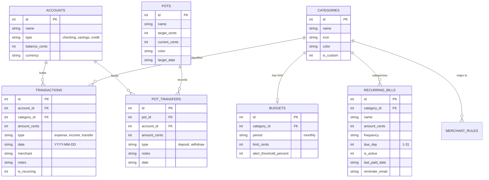

# VaultFlow - Personal Finance Manager

> **"Built a personal finance manager with transaction tracking, budget management, and spending analytics. Demonstrates handling sensitive financial data with proper input validation, complex data relationships with foreign keys, and data aggregation using SQL for reporting dashboards."**

VaultFlow is a full-stack personal finance web application engineered to model complex financial relationships, perform advanced relational data aggregation using SQL window functions and CTEs, enforce integer-cents precision for monetary integrity, and deliver clear, accessible data visualizations.

---

## 🌟 Core Highlights & Architectural Strengths

- **Financial Decimal Precision Architecture**: All monetary figures across the database, API, business logic, and aggregations are stored and processed strictly as integer cents (e.g., `$45.99` is stored as `4599` cents). This guarantees zero IEEE-754 floating-point drift or rounding anomalies.
- **Advanced SQLite Window Functions**: Employs `ROW_NUMBER() OVER (PARTITION BY category_id ORDER BY date DESC)` to fetch the latest 3 transactions partitioned by budget category in a single high-efficiency SQL query.
- **Common Table Expressions (CTEs)**: Computes month-over-month spending and income deltas using SQL CTEs.
- **Smart Recurring Cadence Detection**: Historical pattern recognition engine that identifies repeating ~30-day transactions from bank history and suggests them as trackable recurring bills with one click.
- **Zero-Native-Dependency SQLite Database**: Utilizes Node 24's native `node:sqlite` (SQLite 3.53), ensuring lightning-fast synchronous queries and transactional integrity without external native compilation issues.
- **Strict Pagination & Keyboard-First Accessibility**: 10 transactions per page with full keyboard navigation (`[` / `]` for pagination, `/` to focus search, `n` for new transaction, `?` for cheat sheet).
- **CSV Import & Export Engine**: Validates date formats, row integrity, and currency values on import, automatically flags budget threshold breaches, and supports RFC-4180 CSV exports.

---

## 📐 Data Model & Schema Relationships



---

## 🚀 Key Features

### 1. Financial Overview Page
- **Executive Summary Cards**: Real-time Net Balance, Monthly Income, Monthly Spending, and Net Savings Rate with month-over-month percentage changes.
- **Cash Flow History Chart**: Multi-month interactive income vs. expense bar chart built with Recharts.
- **Spending by Category Donut Chart**: Category distribution breakdown with visual color legends and percentages.
- **AI Spending Insights**:
  - Top 3 spending categories for the billing period.
  - Unusual spending spike detector flagging transactions exceeding 2.0x the historical category average.
  - Real-time budget threshold warnings.
- **Quick-Access Widgets**: Budget consumption bars, Pots goal progress, Upcoming recurring bills, and Recent transactions.

### 2. Transactions (Strict 10 Per Page)
- **10 Items Per Page**: Strictly paginated table with total items count, page navigation, and keyboard shortcut flips (`[` and `]`).
- **Deep Search & Filtering**: Search across merchants and notes (`/` shortcut); filter by category, account, type (expense/income), or date range.
- **Multi-Column Sorting**: Sort by date, amount, merchant, or category.
- **Real-Time Category Auto-Suggestion**: As you type a merchant name (e.g. *Starbucks*, *Uber*, *Netflix*), the system instantly recommends the appropriate category.
- **CSV Transaction Import**:
  - Drag-and-drop or file upload with live preview.
  - Row validation (detects invalid dates, negative amounts, missing merchants).
  - Immediate budget alert summary if imported expenses breach monthly category thresholds.
- **CSV Export**: 1-click RFC-4180 formatted CSV export honoring active filters.

### 3. Category Budgets & Spending
- **Budget vs. Actual Comparisons**: Visual percentage indicators (<75% green, 75-99% amber warning, ≥100% rose overspent).
- **SQL Window Function Integration**: Each budget card displays the **latest 3 transactions** in that category fetched using `ROW_NUMBER() OVER (PARTITION BY category_id ORDER BY date DESC)`.
- **Custom Alert Thresholds**: Configure individual warning thresholds (e.g., trigger warning at 80% or 90% of limit).
- **Custom Category Creation**: Create custom categories on the fly with custom colors and icons directly in the budget modal.

### 4. Saving Pots (Goal Planning)
- **Target Progress Visualization**: Visual progress bars, percentage completed, and remaining amount to save.
- **Target Date & Monthly Contribution Planning**: Calculates months remaining and suggests the exact monthly savings needed to hit the target date.
- **Deposit & Withdraw with Balance Integrity**:
  - *Add Money (Deposit)*: Validates account balance and moves funds into the pot.
  - *Withdraw Money*: Validates pot funds and returns money to the selected account.
- **Transfer History Ledger**: Immutable audit log of all deposits and withdrawals for each pot.

### 5. Recurring Bills & Cadence Detection
- **Current Month Status Tracking**:
  - 🟢 **Paid**: Successfully logged in current billing cycle.
  - 🟡 **Due Soon**: Scheduled within the next 5 days.
  - 🔴 **Overdue**: Due day passed in current month without payment.
  - ⚪ **Upcoming**: Scheduled for later in the month.
- **Smart Pattern Detection Engine**: Backend algorithm analyzes transaction history for recurring cadence (~30-day intervals) and suggests promoting them to tracked bills with 1 click.
- **Simulated Email Notifications**: Test button simulates automated email delivery to the user's email address with a formatted payment reminder notice.
- **Mark as Paid Action**: 1-click payment logging that updates bill status and records the matching expense transaction.

### 6. Keyboard Shortcuts Cheat Sheet (`?`)
| Shortcut | Action |
| :--- | :--- |
| `g` then `o` | Navigate to **Overview** |
| `g` then `t` | Navigate to **Transactions** |
| `g` then `b` | Navigate to **Budgets** |
| `g` then `p` | Navigate to **Saving Pots** |
| `g` then `r` | Navigate to **Recurring Bills** |
| `n` | Open **New Transaction** modal |
| `/` | Focus transaction **Search bar** |
| `[` | **Previous page** in transactions |
| `]` | **Next page** in transactions |
| `?` | Toggle **Keyboard Shortcuts** modal |
| `Esc` | Close any active modal dialog |

---

## 🛠️ Tech Stack

| Layer | Technologies |
| :--- | :--- |
| **Frontend** | React 18, TypeScript, Tailwind CSS, Recharts, Lucide React, Vite |
| **Backend** | Node.js (v24), Express.js, `tsx`, Multer, `csv-parse`, `csv-stringify` |
| **Database** | SQLite 3.53 via Node 24 native `node:sqlite` (zero compilation friction) |
| **Testing** | Vitest test runner (10 automated unit & integration test suites) |

---

## ⚡ Getting Started

### Prerequisites
- Node.js 22+ (tested on Node 24.20.0)
- npm 10+

### 1. Install Dependencies
```bash
npm install
```

### 2. Seed the Database
Populates the SQLite database with multi-month accounts, 60+ realistic transactions, budgets, pots, and recurring bills:
```bash
npm run seed
```

### 3. Run Automated Tests
Executes the Vitest suite covering SQL Window functions, CTEs, integer cents arithmetic, budget alerts, recurring detection, and CSV parsing:
```bash
npm test
```

### 4. Start Development Server
Starts both Express backend (`http://localhost:3001`) and Vite frontend (`http://localhost:5173`) with HMR:
```bash
npm run dev
```

### 5. Production Build & Start
To compile the TypeScript frontend and serve everything through Express on port 3001:
```bash
npm run build
npm start
```
Open **`http://localhost:3001`** in your browser.

---

## 🧪 Automated Test Verification

The test suite in `tests/backend.test.ts` validates:
1. **SQLite Window Function**: `ROW_NUMBER() OVER (PARTITION BY category_id ORDER BY date DESC) <= 3` returns exactly the 3 newest transactions per category.
2. **CTE Aggregations**: Month-over-month comparisons accurately track income and spending differences.
3. **Currency Arithmetic**: String-to-cents parsing and cents-to-currency formatting avoid IEEE-754 floating-point drift.
4. **Budget Alert Thresholds**: Accurately computes `safe`, `warning`, and `exceeded` statuses.
5. **Pattern Detection**: Groups and identifies recurring subscriptions (e.g. *Apple iCloud*, *Barber Shop*) based on 30-day intervals.
6. **CSV Import & Validation**: Validates date formats, amounts, and auto-assigns categories.
7. **Pots Integrity**: Ensures atomic transfers between accounts and saving pots.

---

## 📄 License
MIT License
